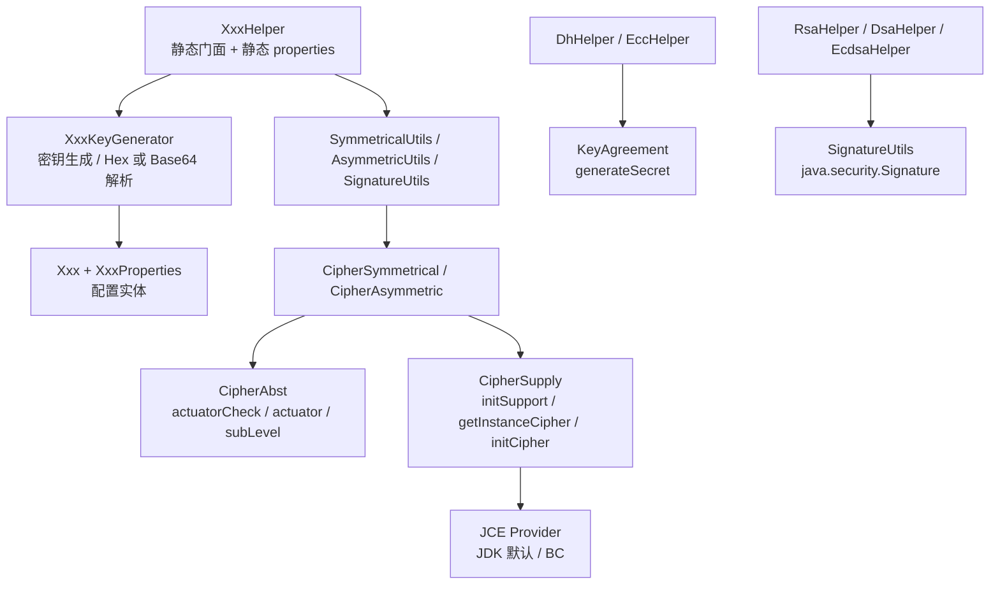

# encrypt 算法设计

> 本文件描述 encrypt 模块的算法分层与落地规范，新增算法时按第 4、5 节执行。

## 1. 概述

`encrypt`（坐标 `io.gitee.sander-o:encrypt`）是 tools 聚合工程的旗舰模块，基于 JDK 的 JCA/JCE 提供对称加密、非对称加密、密钥协商、数字签名、摘要与编码能力。模块**零 Spring 依赖**，仅在 JDK 未内置或需要特定填充时引入 BouncyCastle（IDEA、RSA-OAEP、RC5、Skipjack）。

分层：

| 层 | 包 | 职责 |
|---|---|---|
| basic | `org.tools.encrypt.basic` | 摘要（MD5 / SHA）、Base64、CRC32、JWT；不涉及 Cipher |
| symmetrical | `org.tools.encrypt.symmetrical` | 对称加解密门面、密钥生成、JCE 适配 |
| asymmetric | `org.tools.encrypt.asymmetric` | RSA 加解密、DH / ECDH 密钥协商、密钥对生成 |
| digitalsignature | `org.tools.encrypt.digitalsignature` | DSA / ECDSA / RSA 签名与验签的统一入口 |
| 公共骨架 | `org.tools.encrypt` | `CipherAbst`、`CipherSupplyAbst`、`CipherSupply`、`EncryptKeyGenerator` |

硬约束与统一约定：

- **Java 8 字节码**（class major 52），最低运行 JDK 8；不得使用 `List.of`、`String.isBlank`、`var` 等 JDK 9+ API。
- **明文与解密输出统一 UTF-8**，密文统一 **标准 Base64**；禁止使用 JVM 默认字符集。
- 异常统一包装并保留 cause；`encrypt` 的异常继承链为 `EncryptException → ToolsException → BaseException → RuntimeException`，全部是**非受检异常**，方法签名上的 `throws` 只起声明作用。
- 对称 Helper 使用**静态全局配置**；`load` 替换进程内唯一配置，`encode` / `decode` 每次新建 Cipher。

## 2. 分层架构



- 对称路径：`XxxHelper` → `XxxKeyGenerator` → `SymmetricalUtils` → `CipherSymmetrical` → `CipherSupply` → `Cipher.doFinal`。`CipherSymmetrical.subLevel` 返回 `null`，对称算法**不分块**。
- 非对称路径：`RsaHelper` → `RsaKeyGenerator` → `AsymmetricUtils` → `CipherAsymmetric` → `CipherSupply` → 按 `maxBlock` 循环 `Cipher.doFinal`。
- 协商路径：`DhHelper` / `EccHelper` → `DhKeyGenerator` / `EccKeyGenerator` → `KeyAgreement`；不接入 `AsymmetricUtils` / `CipherAsymmetric`。
- 签名路径：`RsaHelper` / `DsaHelper` / `EcdsaHelper` → `SignatureUtils` → `java.security.Signature`；每次调用新建实例。
- 密钥生成器工厂：`EncryptKeyGenerator.getKeyGenerator` / `getKeyPairGenerator` 每次返回**新实例**（JCA 生成器非线程安全，禁止缓存共享）。

## 3. 算法矩阵

### 3.1 对称算法

| 算法 | 分类 | Provider | 密钥语义 | 默认模式 | 默认位数 | 主要类 | 安全等级 |
|---|---|---|---|---|---|---|---|
| AES | 对称分组 | JDK 默认 | Hex，解码后 16/24/32 字节 | `AES/CBC/PKCS5Padding` | 256（Properties）；随机生成默认 128 | `AesHelper` / `AesKeyGenerator` | 推荐 |
| DES | 对称分组 | JDK 默认 | **原始字符串**，UTF-8 后恰好 8 字节 | `DES`（= ECB/PKCS5Padding） | 56 | `DesHelper` / `DesKeyGenerator` | legacy |
| 3DES（DESede / TDEA） | 对称分组 | JDK 默认 | Hex，16 或 24 字节；16 字节自动扩展为 K1‖K2‖K1 | 仅 `DESede/CBC/PKCS5Padding`（其它模式 `load` 直接拒绝） | 168 | `Des3Helper` / `Des3KeyGenerator` | legacy |
| IDEA | 对称分组 | BC | Hex，16 字节（32 个 Hex 字符） | `IDEA/ECB/ISO10126Padding` | 128 | `IdeaHelper` / `IdeaKeyGenerator` / `IdeaUtils` | 可用 |
| Blowfish | 对称分组 | JDK 默认 | Hex，4~56 字节 | `Blowfish`（= ECB/PKCS5Padding） | 128 | `BlowfishHelper` / `BlowfishKeyGenerator` | legacy |
| RC2 | 对称分组 | JDK 默认 | Hex，5~128 字节（SunJCE 最小 40 位） | `RC2`（= ECB/PKCS5Padding；ECB/CBC 均按密钥长度计算 effective bits） | 128 | `Rc2Helper` / `Rc2KeyGenerator` | legacy |
| RC4 | 对称流 | JDK 默认（KeyGenerator 别名 `ARCFOUR`） | Hex，5~128 字节 | `RC4`（无 IV、无填充、无分组） | 128 | `Rc4Helper` / `Rc4KeyGenerator` | legacy |
| RC5 | 对称分组 | BC | Hex，默认 16 字节；受 `Cipher.getMaxAllowedKeyLength("RC5")`（JDK 8 默认 128，JDK 9+ 无限）与 RFC 2040 的 255 字节上限共同约束 | `RC5`（ECB；12 轮 / 64 位块 / 32 位字） | 128 | `Rc5Helper` / `Rc5KeyGenerator` | legacy |
| Skipjack | 对称分组 | BC | Hex，恰好 10 字节 | `SKIPJACK`（= ECB/PKCS5Padding） | 80 | `SkipjackHelper` / `SkipjackKeyGenerator` | legacy |

补充：

- CBC 模式当前覆盖 `AES/CBC/PKCS5Padding`、`DESede/CBC/PKCS5Padding`、`Blowfish/CBC/PKCS5Padding`、`RC2/CBC/PKCS5Padding`、`RC5/CBC/PKCS5Padding`、`SKIPJACK/CBC/PKCS5Padding`；IV 按 UTF-8 取字节，除 AES 为 16 字节外均为 8 字节。
- `DES_ECB_NO_PADDING` 已登记在 `AlgorithmModeEnum`，但 DES 默认仍是 ECB/PKCS5Padding。
- `tdea` 包没有独立实现，只是 `DESede` 的命名对照，实现在 `symmetrical/des/des3`。
- 表中 RC2 / RC4 / RC5 / Blowfish 的字节范围是 KeyGenerator 允许的算法范围；实际可用上限还受 `Cipher.getMaxAllowedKeyLength(...)` 约束（本机 JDK 8u121 实测均为 128 位）。

### 3.2 非对称加密与密钥协商

| 算法 | 分类 | Provider | 密钥语义 | 默认模式 | 默认位数 | 主要类 | 安全等级 |
|---|---|---|---|---|---|---|---|
| RSA | 非对称加解密 + 签名 | JDK 默认（SunJCE）；BC 变体 `OAEPWithSHA__256AndMGF1Padding` 显式走 BC | Base64(X.509) 公钥 / Base64(PKCS#8) 私钥 | `RSA/ECB/OAEPWITHSHA-256ANDMGF1PADDING` | 2048（Properties）；`Rsa` 实体默认 1024 | `RsaHelper` / `RsaKeyGenerator` | 推荐（2048 位以上 + OAEP） |
| DH | 密钥协商 | JDK 默认 | Base64(X.509) / Base64(PKCS#8)，公钥携带 (p, g) | `DH` | 2048（最小 512，须为 64 的倍数） | `DhHelper` / `DhKeyGenerator` | 可用 |
| ECDH（`EC`） | 密钥协商 | JDK（SunEC） | Base64(X.509) / Base64(PKCS#8) | `EC`，`ECDH` 协商 | 256 / `secp256r1` | `EccHelper` / `EccKeyGenerator` | 推荐 |

### 3.3 数字签名

| 算法 | 分类 | Provider | 密钥语义 | 默认签名算法 | 默认位数 | 主要类 | 安全等级 |
|---|---|---|---|---|---|---|---|
| RSA 签名 | 签名 | JDK（SunRsaSign） | Base64(X.509) / Base64(PKCS#8) | `SHA256withRSA` | 2048 | `RsaHelper` + `SignatureUtils` | 推荐 |
| DSA | 签名 | JDK 默认 | Base64(X.509) / Base64(PKCS#8) | `SHA256withDSA` | 1024 | `DsaHelper` / `DsaKeyGenerator` + `SignatureUtils` | 可用（历史兼容） |
| ECDSA | 签名 | JDK（SunEC） | Base64(X.509) / Base64(PKCS#8) | `SHA256withECDSA` | 256 / `secp256r1` | `EcdsaHelper` / `EcdsaKeyGenerator` + `SignatureUtils` | 推荐 |

`SignAlgorithmEnum` 已登记的签名名：`MD5withRSA`（legacy）、`SHA256withRSA`、`SHA256withDSA`、`SHA256withECDSA`、`SHA3-256withRSA`（JDK 8 默认 Provider 不可用）。

### 3.4 摘要（basic 层）

| 算法 | 分类 | Provider | 默认位数 | 主要类 | 安全等级 |
|---|---|---|---|---|---|
| MD5 | 摘要 | JDK | 128 | `MD5Utils` | legacy |
| SHA-1 | 摘要 | JDK | 160 | `ShaUtils` | legacy |
| SHA-256 / SHA-384 / SHA-512 | 摘要 | JDK | 256 / 384 / 512 | `ShaUtils` | 推荐 |

CRC32 与 Base64 只是校验/编码能力，不属于密码学算法，不在此矩阵的安全等级讨论范围内。

## 4. 新增算法的落地清单

以新增对称算法 `Foo` 为例；非对称、签名、协商算法按同样顺序落到对应包。

| 类别 | 需要新建 / 修改的文件 | 要点 |
|---|---|---|
| Helper | `symmetrical/foo/FooHelper.java` | 静态 `properties`；`load(KeyPair, String)` / `load(KeyPair)` / `load(FooProperties)`；`encode` / `decode` 各三个重载；`@Getter getProperties()`；CBC 模式校验 IV |
| KeyGenerator | `symmetrical/foo/FooKeyGenerator.java` | `getSecretKey()`、`getSecretKey(int keyBits)`、`getSecretKey(String algorithm, String secretKey)`、`getSecretKeyStr(SecretKey)`、`getProperties()`；密钥字符串统一 Hex 或按层约定 |
| 实体 | `entity/symmetrical/Foo.java` | `extends KeyPair`；补 `enabled`、`algorithmMode`、`algorithm`、`keyBits`、`secretKey`、`groupEnabled`、`group`；在 `Symmetrical` 中新增字段 |
| Properties | `entity/symmetrical/FooProperties.java` | `extends EncryptProperties`；在初始化块中设置 `algorithm`、`algorithmMode`、`keyBits` 默认值 |
| 异常 | `exception/symmetrical/foo/FooException.java` | `extends SymmetricalException`；补齐五个构造器；同包 `package-info.java` |
| package-info | `symmetrical/foo/package-info.java` | 描述包职责；父包与叶包都要有 |
| 测试 | `src/test/java/.../FooHelperTest.java`、`FooKeyGeneratorTest.java` | JUnit 4；按第 7 节覆盖 |

非对称算法额外：实体与 Properties 放到 `entity/asymmetric`，并在 `Asymmetric` 聚合根中登记；异常继承 `AsymmetricException`。签名算法放到 `digitalsignature/foo`，Properties 放到 `entity/digitalsignature`（DSA / ECDSA 没有 `KeyPair` 子类），异常继承 `DigitalSignatureException`。

### 4.1 三处全局登记点

| 登记点 | 位置 | 作用 | 漏登记的后果 |
|---|---|---|---|
| `AlgorithmEnum` | `enums/AlgorithmEnum.java` | 算法名 → 枚举，供 `CipherSymmetrical` / `CipherAsymmetric` 使用 | `AlgorithmEnum.enumName(...)` 内部 `.findFirst().get()` 抛 `NoSuchElementException` |
| `AlgorithmModeEnum` | `enums/AlgorithmModeEnum.java` | 完整转换模式名（如 `Foo/CBC/PKCS5Padding`）→ 枚举 | `AlgorithmModeEnum.enumName(...)` 同样抛 `NoSuchElementException` |
| `CipherSupply` | `CipherSupply.java` 的三个 switch | Provider 注册、Cipher 创建、Cipher 初始化 | 见下 |

`CipherSupply` 三个 switch 的实际职责与失败行为：

1. `initSupport(AlgorithmModeEnum)`：对需要 BC 的模式调用 `Security.addProvider(new BouncyCastleProvider())`。当前分支：`IDEA`、`IDEA_ECB_ISO10126Padding`、`OAEPWithSHA__256AndMGF1Padding`、`RC5`、`RC5_CBC_PKCS5PADDING`、`SKIPJACK`、`SKIPJACK_CBC_PKCS5PADDING`。漏登记会导致后续 `Cipher.getInstance` 找不到 Provider 而抛 `NoSuchAlgorithmException`。
2. `getInstanceCipher(AlgorithmModeEnum)`：`OAEPWithSHA__256AndMGF1Padding` 显式用 `"BC"` 创建；`RC5`、`RC5_CBC_PKCS5PADDING`、`SKIPJACK`、`SKIPJACK_CBC_PKCS5PADDING` 显式用 `"BC"`；其余（包括默认 RSA 模式）走 `Cipher.getInstance(algorithmMode.getAlgorithmMode())` 的默认 Provider 查找。JDK 不提供的算法若漏登记，同样抛 `NoSuchAlgorithmException`。
3. `initCipher(...)`：按模式决定是否传 IV、`SecureRandom`、`RC5ParameterSpec`、`RC2ParameterSpec` 或 `OAEPParameterSpec`。当前分支：`RSA_ECB_OAEPWITHSHA__256ANDMGF1PADDING`；`IDEA` / `IDEA_ECB_ISO10126Padding` / `DES_ECB_NO_PADDING` / `BLOWFISH` / `RC2` / `RC4` / `SKIPJACK`；`AES` / `DES` / `RSA`；`AES_CBC_PKCS5PADDING` / `DES_EDE_CBC_PKCS5Padding` / `BLOWFISH_CBC_PKCS5PADDING` / `SKIPJACK_CBC_PKCS5PADDING`；`RC5`；`RC5_CBC_PKCS5PADDING`；`RC2_CBC_PKCS5PADDING`；`OAEPWithSHA__256AndMGF1Padding`。**漏登记会落到 `default` 分支，抛 `CipherSupplyException`**（消息含 `Encrypt mode %s did not find the corresponding initialization scheme!`）。

签名算法还需在 `SignAlgorithmEnum` 登记；`SignatureUtils` 直接接收字符串，不经过 `enumName`，所以漏登记不会立刻报错，但按名查找与配置校验会失效。

## 5. 统一代码模式

### 5.1 `load` 与分组机制

- `load(KeyPair keyPair, String name)`：要求实体是具体子类（如 `Aes`、`Blowfish`、`Rc4`），并校验 `enabled == true`；当 `groupEnabled == true` 且 `group` 非空时，按 `name` 匹配分组，先用顶层实体的缺省字段补齐分组（对称 Helper 与 RSA 补 `algorithm`、`keyBits`、`algorithmMode`、`signAlgorithm`；DH 补 `algorithm`、`keyBits`；ECC 传顶层 `curve`），再调用 `load(group)`。
- **未匹配到 `name` 时实际回退为 `load(keyPair)`**，不会抛“分组不存在”异常；部分 Javadoc 写的是“分组不存在时抛出”，以代码行为为准。
- `load(KeyPair)`：把字符串密钥解析为 `SecretKey` / `PublicKey` / `PrivateKey`，再组装 `XxxProperties`。
- `load(XxxProperties)`：校验密钥对象非空；CBC 模式还会校验 IV 长度；最后替换静态 `properties`。
- Helper 的 `getProperties()` 返回当前激活配置：多数对称 Helper 初始化为 `new XxxProperties()`，未 `load` 时返回默认配置对象；`DesHelper`、`DsaHelper`、`EcdsaHelper` 的 `properties` 初始为 `null`，未 `load` 时直接返回 `null`。KeyGenerator 的 `getProperties()` / `getXxxProperties()` 会在缺密钥时**自动生成并回填**密钥。两者语义不同，不要混用。

### 5.2 静态 properties 与并发边界

- 每个 Helper 持有 `private static XxxProperties properties`，`load` 直接替换引用。字段未加 `volatile`，`properties` 对象本身可变。
- **`load` 与 `encode` / `decode` 并发不安全**：编码过程中会多次读取 `properties.getAlgorithm()`、`getAlgorithmMode()`、`getSecretKey()`，并发 `load` 可能读到新旧混合的配置。
- **多次 `encode` / `decode` 之间线程安全**：每次调用新建 `Cipher`；签名同理，每次新建 `Signature`。
- 多组密钥优先用 `load(KeyPair, name)` 分组，或使用显式传 `SecretKey` / `PublicKey` / `PrivateKey` 的重载，避免依赖全局状态。
- `RsaKeyGenerator` / `DsaKeyGenerator` / `EcdsaKeyGenerator` / `DhKeyGenerator` / `EccKeyGenerator` 对**默认密钥对**使用双检锁缓存；显式的 `generateKeyPair(...)` 每次新建。

### 5.3 异常包装

- 统一层次：`SymmetricalException` / `AsymmetricException` / `DigitalSignatureException` 继承 `EncryptException`；各算法异常再继承对应父类。
- 包装时传入原始异常（`new FooException(e)`），保留 cause，禁止吞掉 JCE 异常。
- 现状差异：`SymmetricalUtils` / `AsymmetricUtils` 把 JCE 异常包装为**父级**异常，部分 Helper 不再转换为算法专属异常；`EcdsaHelper` 会把 `DigitalSignatureException` 再包装为 `EcdsaException`，而 `DsaHelper.sign` 直接向上抛 `DigitalSignatureException`。新增算法应明确本层的包装策略，至少保证不把原始 `InvalidKeyException` 等直接抛给调用方。

### 5.4 Base64 与 Hex 的现状差异

- 对称路径的 Base64：`SymmetricalUtils` 使用 `java.util.Base64`。
- 非对称与签名路径的 Base64：`AsymmetricUtils`、`SignatureUtils`、`RsaKeyGenerator`、`DsaKeyGenerator`、`EcdsaKeyGenerator`、`DhKeyGenerator`、`EccKeyGenerator` 使用 `org.apache.commons.codec.binary.Base64`。
- 对称密钥字符串统一使用 `commons-codec` 的 `Hex`；DES 是唯一例外（原始 UTF-8 字符串）。
- 两者产出的都是标准 Base64（不是 URL-safe），可以互通；新增代码应向所在层的既有实现看齐，不要在同一路径混用两种 API。

## 6. 非对称与签名的特殊形态

- **密钥字符串格式**：RSA / DSA / ECDSA / DH / ECDH 的公钥为 Base64(X.509)，私钥为 Base64(PKCS#8)。`KeyFactory` 必须传**密钥算法名**（`RSA` / `DSA` / `EC` / `DH`），不能传签名算法名（如 `SHA256withDSA`），否则 `NoSuchAlgorithmException`。
- **RSA 分块**：`CipherAsymmetric.subLevel` 按 `maxEncryptBlock` 循环 `doFinal`，密文是各块输出的直接拼接（无长度前缀），解密端按 `maxDecryptBlock = keyBits/8` 切分。`AsymmetricUtils` 在调用方传入 `<= 0` 时回退为加密 117 / 解密 128；`RsaProperties.recalcMaxBlocks()` 会按模式与位数重算（2048 位 OAEP-SHA256 为加密 190 / 解密 256）。
- **DH**：只有 `generateKeyPair()`、`generateKeyPair(int)`、`generateKeyPair(DHParameterSpec)`、`generateSharedSecret(PrivateKey, PublicKey)`、`generateSharedSecretStr(...)`、`getParams(PublicKey)`；没有 `encode` / `decode`。协商双方必须使用同一组域参数（通常由一方公钥携带）。
- **ECDH**：使用 JDK `KeyAgreement.getInstance("ECDH")`；P-256 / P-384 / P-521 的原始共享秘密分别为 32 / 48 / 66 字节。
- **共享秘密必须经过 KDF**：`KeyAgreement.generateSecret()` 的原始输出分布不均匀，不能直接作为 AES 密钥。调用方需用 HKDF / SHA-256 等结合双方公钥、盐值与上下文派生会话密钥；`DhHelper` / `EccHelper` 只返回原始字节或 Base64。
- **签名形态**：`SignatureUtils.sign(signAlgorithm, privateKey, wrought)` 返回 Base64 签名；`verify(...)` 返回 `boolean`。待签数据与验签数据都按 UTF-8 取字节。`DsaHelper` / `EcdsaHelper` 提供全局配置、Base64 密钥字符串、密钥对象三种入口；`RsaHelper` 同时提供加密与签名入口。
- **ECDSA 的密钥算法名是 `EC`**，签名算法名是 `SHA256withECDSA`；两者不可混用。

## 7. 测试规范

- 测试框架固定为 **JUnit 4**（`org.junit.Test` / `org.junit.Assert`），Mockito 4.11.0 可用；不要引入 JUnit 5。当前 `encrypt` 有 41 个测试类、344 个 `@Test` 方法。
- 每个 Helper / KeyGenerator 至少一个同名测试类（`XxxHelperTest`、`XxxKeyGeneratorTest`）；并发相关用例放在 `SignatureUtilsConcurrencyTest`。
- 命名沿用现有冒烟风格：`testLoadKeyPair`、`testLoadKeyPairNamed`、`testLoadProperties`、`testGetProperties`、`testEncodeDecodeWithGlobalConfig`、`testEncodeDecodeWithHexKey`、`testEncodeDecodeWithSecretKey`、`testGeneratedKeyRoundTrip`、`testNonHexKeyRejected`、`testWrongKeyPairTypeRejected`、`testChineseRoundTripUsesUtf8Consistently`、`testCbcMode...`、`testKnownAnswer...`。
- 覆盖要求：对称 Helper 的 `load` 三种重载、`encode` 三个重载、`decode` 三个重载、`getProperties`；签名 Helper 覆盖 `sign` / `verify` 的三种入口（全局配置、字符串密钥、密钥对象）；非对称另覆盖密钥生成与字符串/对象互转。DSA / ECDSA 只有 `load(KeyPair)` 与 `load(XxxProperties)` 两种重载，不强行凑三个。
- 已知答案向量（KAT）来源：

| 算法 | 来源 | 断言 | 测试类 / 方法 |
|---|---|---|---|
| RC4 | RFC 6229 | key `0102...0f10`，16 个 `0x00` → `9ac7cc9a609d1ef7b2932899cde41b97` | `Rc4HelperTest.testKnownAnswerRfc6229` / `testKnownAnswerThroughHelper` |
| RC2 | RFC 2268 | 零密钥、有效密钥位 63、零明文 → `ebb773f993278eff` | `Rc2HelperTest.testKnownAnswerRfc2268` |
| Blowfish | 经典向量 | 零密钥、零明文 → `4ef997456198dd78` | `BlowfishHelperTest.testKnownAnswerVector` |
| 3DES | JCE 对照 | 24 字节密钥、`DESede/ECB/NoPadding` → `8eaeb1ea7f2755a5` | `Des3HelperTest.testKnownAnswerWithJce` |
| RC5 / Skipjack | 无公开标准向量 | 只做 round-trip、确定性与长度断言 | `Rc5HelperTest` / `SkipjackHelperTest` |

- **不要编造标准向量**。没有可靠外部向量的算法，至少断言：同一密钥同一明文密文相同（确定性）、解密可还原（round-trip）、密文 Base64 可解码。
- 构建命令（根 POM 默认 `skipTests=true`，必须显式开启）：

```bash
mvn -B -DskipTests=false -pl encrypt -am test
```

## 8. 安全与限制

- **JCE 策略上限**：早期 JDK 8 默认策略将对称密钥限制为 128 位，AES-256 需要 8u161+ 或安装 unlimited strength policy。`BlowfishKeyGenerator`、`Rc2KeyGenerator`、`Rc4KeyGenerator`、`Rc5KeyGenerator` 会用 `Cipher.getMaxAllowedKeyLength(...)` 做运行时校验；超过上限直接拒绝。
- **Provider 优先级**：BC 通过 `Security.addProvider(...)` **追加到末尾**，不覆盖 JDK 默认 Provider。仅 BC 专属的 `OAEPWithSHA__256AndMGF1Padding`（注意没有 `RSA/ECB/` 前缀）、RC5、Skipjack 在创建 Cipher 时显式指定 `"BC"`；默认 RSA 模式 `RSA/ECB/OAEPWITHSHA-256ANDMGF1PADDING` 由 JDK 的 SunJCE 提供，不经过 BC。IDEA 只登记了 BC 注册，创建 Cipher 时仍走默认查找（JDK 不提供 IDEA，因此会落到 BC）。
- **ECIES 不可用**：JDK 8 默认 JCE 策略下 `Cipher.getMaxAllowedKeyLength("ECIES")` 为 128，P-256 会被拒绝；BC 的 ECIES 又不接受 SunEC 生成的密钥。因此 `EccHelper` 只提供 ECDH，不提供 ECIES。
- **legacy 算法警示**：DES（56 位）、3DES、Blowfish、RC2、RC4、RC5、Skipjack 仅用于兼容既有系统；其中 DES / 3DES / Blowfish / IDEA / RC2 / RC5 / Skipjack 均为 64 位分组，存在生日界与 Sweet32 类风险，RC4 还有密钥流统计偏差。新设计优先 AES；签名优先 RSA-2048+ / ECDSA P-256+。
- **DES 默认 ECB**：`DesHelper` 默认模式为 `DES`（ECB/PKCS5Padding），IV 被忽略。这是为兼容既有密文保留的行为，新代码应显式改用更安全的模式或直接使用 AES。
- **CBC 的 IV 不随机**：当前 IV 来自配置字符串，不会为每条消息生成随机 IV；同一密钥重复加密同一明文会得到相同密文。需要语义安全时，应由上层生成随机 IV 并随密文传输（当前 API 未内置该流程）。
- **无认证加密**：模块没有 GCM / ChaCha20-Poly1305 等 AEAD 封装，密文不提供完整性保护；需要防篡改时应叠加 HMAC 或改用签名。
- **密钥材料可能进日志**：`SymmetricalUtils.encode` / `decode` 在失败时会把 `secretKey`、`ivParameter` 打进 `log.error`。生产环境需评估日志脱敏或调整日志级别。
- **并发边界**：再次强调 `load` 与 `encode` / `decode` 并发不安全；多线程场景应在启动阶段完成 `load`，或使用显式密钥重载。

## 9. 未实现算法

| 算法 | 状态 | 原因 |
|---|---|---|
| ElGamal | 仅 `asymmetric/elgamal/package-info.java` 占位 | JDK 没有现成 JCE `Cipher`，需自行实现模幂、参数生成、填充与密钥规范 |
| Knapsack | 仅 `asymmetric/knapsack/package-info.java` 占位 | 无 JCE 实现，且历史背包方案多已不安全，需自研并重新评估安全性 |
| Rabin | 仅 `asymmetric/rabin/package-info.java` 占位 | 无 JCE 实现，涉及模平方根与解密歧义处理，需自研 |
| ECIES | 未实现 | 见第 8 节：JDK 8 策略限制与 BC / SunEC 密钥不兼容 |
| TDEA | 仅 `symmetrical/tdea/package-info.java` 占位 | TDEA 即 3DES，实现已统一放在 `symmetrical/des/des3`，不重复建类 |

这些占位包保留了包结构规划，README 能力矩阵中以 ⛔ 标注；不要误认为可用，也不要顺手删除。
